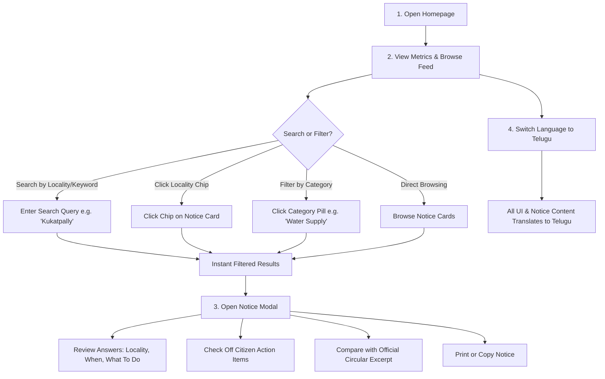
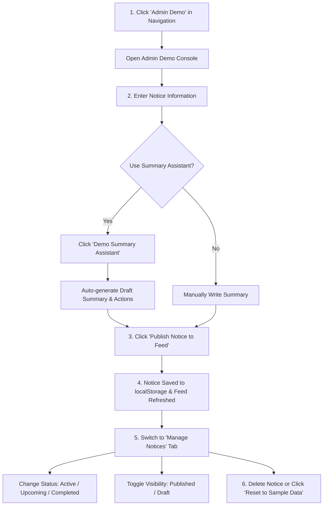
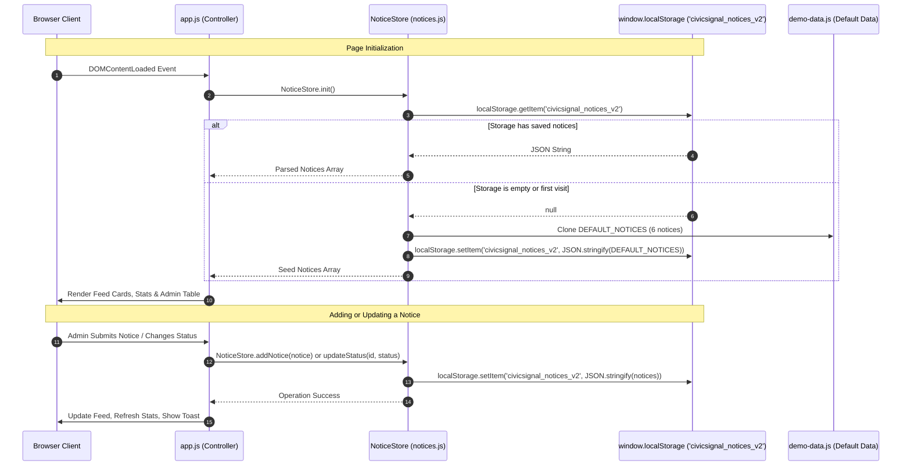

# CivicSignal AI — User & Data Workflows

**Project Theme:** Citizen Engagement and Public Services  
**Project Name:** CivicSignal AI  
**Tagline:** Important local information, made easy for everyone.  

This document details the three primary operating workflows of CivicSignal AI:
1. **Citizen Workflow** (Public User Journey)
2. **Administrator Demo Workflow** (Content Management Journey)
3. **Data Lifecycle Workflow** (Persistence & State Management)

---

## A. Citizen Workflow

### Step 1: Open the Homepage
- The citizen opens the web application in any standard web browser on desktop or mobile.
- The hero section displays the core mission: *"Important local information, made easy for everyone."*
- Quick stats highlight active alerts, upcoming notices, affected localities, and supported languages.

### Step 2: Browse or Search Public Notices
- **Live Search**: The citizen types a query into the central search bar (e.g., `"Kukatpally"`, `"outage"`, `"health"`, or a circular reference number).
- **Locality Chip Click**: Clicking on any highlighted location chip on a card immediately filters the feed for that locality.
- **Category Filter Pills**: Clicking category pills filters the feed instantly without reloading.

### Step 3: Open a Notice for Full Breakdown
- The citizen clicks **"View Citizen Breakdown"** on any card to open the modal dialog.
- The modal highlights:
  1. **Plain-Language Summary**: The core announcement in 3–4 sentences.
  2. **Dates & Timings**: Verified calendar schedule and hours.
  3. **Affected Localities**: Specific municipal wards and neighborhoods.
  4. **Interactive Action Checklist**: Steps the citizen must take, with live percentage progress tracking.
  5. **Verification Container**: Reference number and demonstration status disclaimer.
  6. **Original Official Circular Text**: Expandable accordion comparing complex bureaucratic text with the plain summary.
  7. **Print & Copy Tools**: One-click printable view or summary clipboard copy.

### Step 4: Switch Between English and Telugu Demo Content
- The citizen clicks the **"తెలుగు"** button in the top navigation header.
- The entire interface, navigation labels, category pills, notice titles, summaries, and action items instantly translate into Telugu.

---

## B. Administrator Demo Workflow

### Step 1: Open the Admin Demo Page
- Click **"🛠️ Admin Demo"** in the top navigation. The view transitions smoothly with a simulation disclaimer.

### Step 2: Enter Notice Details
- In the **"Publish New Notice"** tab, enter title, category, department, dates, timings, affected locations, actions, priority, and original circular text.

### Step 3: Utilize the Demo Summary Assistant
- Click **"✨ Demo AI Summary Assistant — Simulated"** to generate a structured draft summary and suggested actions based on the entered text using client-side rule templates.
- Review and refine the draft before publishing.

### Step 4: Publish Notice to Feed
- Click **"📢 Publish Notice to Feed"**.
- Form validation confirms all required fields are filled.
- An official reference number (e.g., `DEMO-REF: CS/WATER/2026/894`) is auto-generated and saved to `localStorage`.
- The view automatically switches to the **"Manage Notices"** table with a success toast.

### Step 5: Update Status or Visibility
- Change notice status between `Active`, `Upcoming`, and `Completed`.
- Toggle between `Published` (visible to citizens) and `Draft` (hidden from citizens).

### Step 6: Delete or Reset Sample Data
- Delete unwanted notices.
- Click **"🔄 Reset to Sample Demo Data"** anytime to restore the original 6 sample notices.

---

## C. Data Lifecycle Workflow

